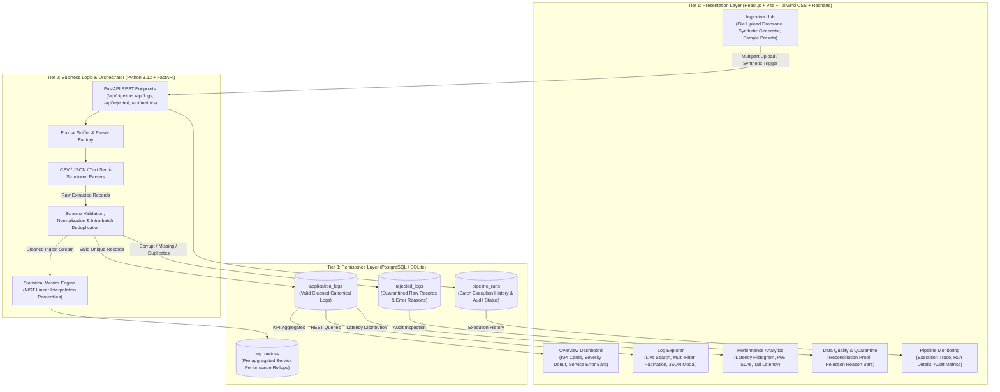

# Application Log Analytics & Monitoring Platform

A production-grade, three-tier Data Engineering platform designed to ingest, parse, validate, and normalize structured (CSV, JSON) and semi-structured (syslog/regex text) application logs, quarantine corrupt entries, prevent duplicates, and calculate real-time error rate and tail latency metrics.

---

## 1. Executive Summary & Problem Context

Modern distributed applications generate millions of log events across multiple microservices. These logs arrive in heterogeneous, noisy formats—some as structured CSV/JSON payloads, others as unstructured text lines with timestamps, error levels, and key-value attributes.

### Core Objectives
1. **Automated Multi-Format Ingestion:** Ingest CSV, JSON (Array & Lines), and semi-structured text logs with automatic format sniffing.
2. **Standardization & Normalization:**
   - Normalize varied timestamps into timezone-aware UTC ISO-8601 strings.
   - Canonicalize log severities to standard uppercase (`INFO`, `WARNING`, `ERROR`, `CRITICAL`).
   - Generate deterministic, collision-resistant event IDs (SHA-256) when missing.
3. **Data Quality & Zero Silent Loss:**
   - Strict schema validation detecting missing fields, unparseable timestamps, and negative response times.
   - Corrupt or duplicate records are quarantined in `rejected_logs` with the exact raw line and descriptive failure reason.
4. **Idempotent Ingestion:**
   - Primary key constraints and batch deduplication ensure identical reruns never create duplicate target rows.
5. **Operational Analytics:**
   - Compute global and per-service error rates:
     $$\text{Error Rate } \% = \frac{\text{Count}(\text{ERROR}) + \text{Count}(\text{CRITICAL})}{\text{Total Valid Logs}} \times 100$$
   - Calculate response time distributions: Average, Min, Max, Median (P50), P95, and P99 latency percentiles.

---

## 2. Three-Tier Decoupled Architecture

The platform strictly isolates presentation, business processing, and persistence layers:



---

## 3. Data Dictionary & Entity Relationships

The relational model supports high-throughput batch ingestion, query filtering, and auditability. The complete PostgreSQL DDL is located in [`database/schema.sql`](file:///c:/CandidateWorkspace/database/schema.sql).

### Table 1: `pipeline_runs`
- **Grain:** One record per batch ingestion execution (upload or synthetic run).
- **Primary Key:** `run_id` (VARCHAR 64, e.g. `RUN_20261114_085150_B24CDD`).
- **Columns:**
  | Column Name | Data Type | Nullable | Description |
  | :--- | :--- | :--- | :--- |
  | `run_id` | VARCHAR(64) | NO | Deterministic / timestamped unique run identifier |
  | `source_file` | VARCHAR(255) | NO | Name of uploaded or generated source file |
  | `file_format` | VARCHAR(32) | NO | Detected syntax: `CSV`, `JSON`, `TEXT` |
  | `status` | VARCHAR(32) | NO | `SUCCESS`, `PARTIAL_SUCCESS`, `FAILED` |
  | `start_time` | TIMESTAMP WITH TZ | NO | Pipeline start timestamp in UTC |
  | `end_time` | TIMESTAMP WITH TZ | YES | Pipeline completion timestamp in UTC |
  | `duration_seconds` | FLOAT | YES | Total wall-clock processing time in seconds |
  | `total_input_records` | INTEGER | NO | Total raw rows/objects parsed from input |
  | `valid_records` | INTEGER | NO | Total cleaned rows successfully loaded to `application_logs` |
  | `rejected_records` | INTEGER | NO | Total rows quarantined in `rejected_logs` |
  | `duplicate_records` | INTEGER | NO | Count of intra-batch and cross-batch duplicates |
  | `error_message` | TEXT | YES | Diagnostic stack trace if run failed |

### Table 2: `application_logs`
- **Grain:** One record per unique, validated application event.
- **Primary Key:** `event_id` (VARCHAR 64).
- **Columns:**
  | Column Name | Data Type | Nullable | Description |
  | :--- | :--- | :--- | :--- |
  | `event_id` | VARCHAR(64) | NO | Unique event identifier (provided or deterministic SHA-256) |
  | `run_id` | VARCHAR(64) | YES | Foreign Key referencing `pipeline_runs.run_id` |
  | `timestamp` | TIMESTAMP WITH TZ | NO | Normalized UTC event timestamp (Indexed) |
  | `severity` | VARCHAR(16) | NO | Normalized level: `INFO`, `WARNING`, `ERROR`, `CRITICAL` (Indexed) |
  | `service` | VARCHAR(64) | NO | Microservice name (e.g. `auth`, `payment`, `api-gateway`) (Indexed) |
  | `message` | TEXT | NO | Cleaned log message payload |
  | `response_ms` | FLOAT | YES | API response time in milliseconds (CHECK `>= 0`, Indexed) |
  | `user_id` | VARCHAR(64) | YES | Extracted user identifier (e.g. `USR_101`) |
  | `endpoint` | VARCHAR(255) | YES | HTTP path / API route (e.g. `/api/v1/charge`) |
  | `http_status` | INTEGER | YES | HTTP response status code (e.g. `200`, `500`) |
  | `is_failure` | BOOLEAN | NO | True if severity in (`ERROR`, `CRITICAL`) or HTTP >= 500 |
  | `source_file` | VARCHAR(255) | NO | Provenance trace of originating log file |
  | `ingested_at` | TIMESTAMP WITH TZ | NO | System ingestion timestamp in UTC |

### Table 3: `rejected_logs`
- **Grain:** One record per corrupt, invalid, or malformed input line.
- **Primary Key:** `reject_id` (INTEGER, Autoincrement / SERIAL).
- **Columns:**
  | Column Name | Data Type | Nullable | Description |
  | :--- | :--- | :--- | :--- |
  | `reject_id` | INTEGER | NO | Sequential auto-increment ID |
  | `run_id` | VARCHAR(64) | YES | Foreign Key referencing `pipeline_runs.run_id` |
  | `source_file` | VARCHAR(255) | NO | Originating source file |
  | `raw_record` | TEXT | NO | Unparsed raw record string (exact unadulterated input) |
  | `reason` | VARCHAR(255) | NO | Rejection explanation (e.g. `Negative response time: -350ms`) |
  | `rejected_at` | TIMESTAMP WITH TZ | NO | Quarantine timestamp in UTC |

### Table 4: `log_metrics`
- **Grain:** Pre-aggregated performance and error rollup per service and run.
- **Primary Key:** `metric_id` (INTEGER, Autoincrement / SERIAL).
- **Columns:**
  | Column Name | Data Type | Nullable | Description |
  | :--- | :--- | :--- | :--- |
  | `metric_id` | INTEGER | NO | Sequential metric ID |
  | `run_id` | VARCHAR(64) | YES | Foreign Key referencing `pipeline_runs.run_id` |
  | `service` | VARCHAR(64) | NO | Service identifier |
  | `total_logs` | INTEGER | NO | Count of valid logs for service in batch |
  | `error_count` | INTEGER | NO | Count of `ERROR` logs |
  | `critical_count` | INTEGER | NO | Count of `CRITICAL` logs |
  | `error_rate_pct` | FLOAT | NO | Error rate percentage: `(error + critical) / total * 100` |
  | `avg_latency_ms` | FLOAT | YES | Mean response time (ms) |
  | `p50_latency_ms` | FLOAT | YES | Median (50th percentile) latency (ms) |
  | `p95_latency_ms` | FLOAT | YES | 95th percentile latency (ms) |
  | `p99_latency_ms` | FLOAT | YES | 99th percentile tail latency (ms) |
  | `max_latency_ms` | FLOAT | YES | Peak maximum latency (ms) |

---

## 4. Key Business Calculations & Formulas

### 1. Error Rate Percentage
Defined strictly across valid application logs:
$$\text{Error Rate } \% = \frac{\text{Count}(\text{ERROR}) + \text{Count}(\text{CRITICAL})}{\text{Total Valid Logs}} \times 100$$
*Business Rule:* Warnings are indicators of elevated resource usage or non-critical state, but are **not** counted as failed requests.

### 2. Tail Latency & Percentiles
Calculated using linear interpolation over sorted request latencies ($N$ samples):
- **Average:** $\frac{1}{N} \sum_{i=1}^N \text{latency}_i$
- **Rank $k$:** $k = (N - 1) \times \left(\frac{P}{100}\right)$
- **Interpolated Value:** $V = \text{val}_{\lfloor k \rfloor} + (k - \lfloor k \rfloor) \times (\text{val}_{\lceil k \rceil} - \text{val}_{\lfloor k \rfloor})$

### 3. Conservation Law Audit (Reconciliation)
Every batch must satisfy:
$$\text{Total Input Records} = \text{Valid Stored Records} + \text{Quarantined Records}$$
If $\text{Input} \neq \text{Valid} + \text{Quarantined}$, the batch is flagged as an audit failure.

---

## 5. Quickstart & Setup Instructions

### Prerequisites
- Python 3.10+
- Node.js 18+ and npm
- (Optional) PostgreSQL 14+ (defaults to embedded zero-config SQLite)

### 1. Backend Setup & Startup
```powershell
# Navigate to workspace root
cd c:\CandidateWorkspace

# Configure environment (defaults to SQLite: ./data/logs.db)
cp .env.example .env

# Install backend dependencies
pip install -r backend/requirements.txt

# Run the FastAPI backend server (also automatically serves the React UI at http://localhost:8000)
$env:PYTHONPATH = "backend"
python backend/app/main.py
```
*The API is now live at `http://localhost:8000` with interactive Swagger docs at `http://localhost:8000/docs`.*

### 2. Frontend Development Server (Optional Hot-Reloading)
```powershell
cd c:\CandidateWorkspace\frontend
npm install
npm run dev
```
*Frontend hot-reloading dev server runs at `http://localhost:5173`.*

### 3. Running the Complete Automated Test Suite
```powershell
cd c:\CandidateWorkspace
$env:PYTHONPATH = "backend"
pytest -v
```
**Result:** 25/25 automated unit and integration tests passing.

---

## 6. Reproducible Sample Data & Benchmarking

### 1. Pre-generated Starter Files
Pre-generated datasets are committed in [`data/sample/`](file:///c:/CandidateWorkspace/data/sample):
- `data/sample/sample_logs.csv` — 1,000 structured CSV records
- `data/sample/sample_logs.json` — 1,000 structured JSON records
- `data/sample/sample_logs.log` — 1,000 semi-structured syslog text lines
- `data/sample/quick_starter.json` — 100 quick-review starter records

### 2. Running the 100,000 Records Benchmark
Execute the standalone performance benchmark script:
```powershell
python backend/benchmark.py
```

#### Measured Benchmark Results (100,000 Records)
```text
======================================================================
APPLICATION LOG ANALYTICS - PERFORMANCE BENCHMARK: 100,000 RECORDS
======================================================================
[1/4] Generating 100,000 synthetic application log records...
      Generation completed in 0.92s (108,909 records/sec)
[2/4] Serializing records to CSV payload...
      Payload size: 10.96 MB serialized in 0.55s
[3/4] Ingesting and processing payload through core pipeline...
      Pipeline completed in 15.97 seconds
      Throughput: 6,262 records/sec
      Status: PARTIAL_SUCCESS
[4/4] Audit Reconciliation Verification:
      Total Input Records:   100,000
      Valid Cleaned Records: 97,001
      Quarantined Rejects:   2,999
      Accounted For Sum:     100,000
      Intra-batch Dupes:     541
      Reconciliation Match:  VERIFIED (100% Accounted)
      Error Rate %:          10.05%
      Average Latency:       500.07 ms
======================================================================
```

### 3. Running the Audit Reconciliation Verification
To inspect all recorded pipeline runs and print the reconciliation audit matrix:
```powershell
python backend/reconciliation.py
```
Generates [`reports/reconciliation_report.md`](file:///c:/CandidateWorkspace/reports/reconciliation_report.md).

---

## 7. Edge Cases & Negative Scenarios Tested

All required negative scenarios are verified by automated tests in `backend/tests/`:

| Test Name | Edge Case Covered | System Behavior |
| :--- | :--- | :--- |
| `test_empty_input_handling` | Empty file / zero bytes payload | Handled gracefully; 0 input, 0 rejects, marked `SUCCESS` |
| `test_malformed_json_syntax` | Corrupt unclosed JSON string | Quarantined to `rejected_logs` with syntax error message |
| `test_malformed_csv_column_mismatch` | Row with extra/missing commas | Quarantined to `rejected_logs` with column mismatch error |
| `test_intra_batch_duplicates_quarantined` | Duplicate `event_id` in same batch | First instance loaded; duplicate instance quarantined |
| `test_idempotent_rerun_behavior` | Exact same file re-ingested | Existing IDs detected; 0 duplicates created; safely skipped |
| `test_missing_timestamp_rejected` | Record missing timestamp | Quarantined; `Missing required field: timestamp` |
| `test_missing_severity_rejected` | Record missing severity | Quarantined; `Missing required field: severity` |
| `test_missing_message_rejected` | Record with empty message | Quarantined; `Missing required field: message` |
| `test_domain_edge_case_negative_latency` | Negative latency (e.g. `-50ms`) | Quarantined; `Negative response time: -50.0ms` |
| `test_timestamp_normalizations` | ISO, space-delimited, epoch ms | All parsed into normalized UTC ISO-8601 datetimes |
| `test_severity_case_and_alias_normalization` | `[warning]`, `err`, `fatal` | Canonicalized to `WARNING`, `ERROR`, `CRITICAL` |

---

## 8. Reports & Artifacts Index

- [Architecture Design & Trade-offs Note](file:///c:/CandidateWorkspace/reports/architecture_design.md)
- [Performance Benchmark Report (100k Records)](file:///c:/CandidateWorkspace/reports/performance_benchmark.md)
- [Reconciliation & Quality Audit Report](file:///c:/CandidateWorkspace/reports/reconciliation_report.md)
- [PostgreSQL Schema DDL](file:///c:/CandidateWorkspace/database/schema.sql)
- [Backend Pytest Suite](file:///c:/CandidateWorkspace/backend/tests/test_pipeline.py)
