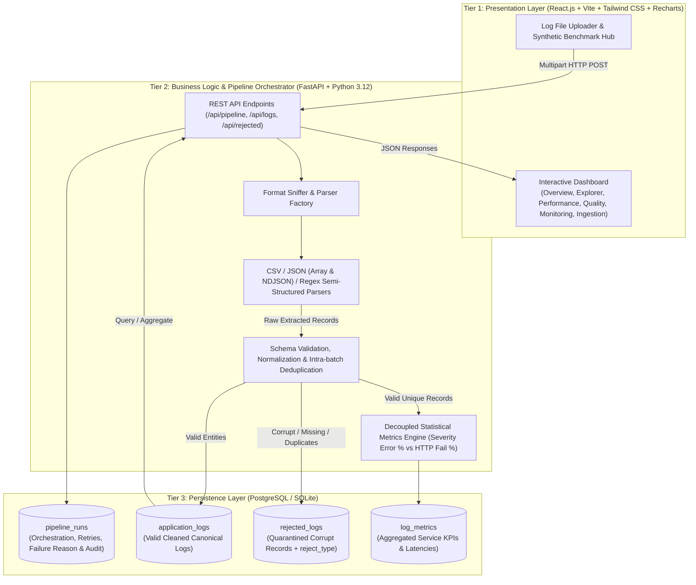

# System Architecture & Technical Trade-offs Note

**Platform:** Application Log Analytics & Monitoring Platform  
**Target Level:** Data Engineer (0–3 Years Experience)  
**Architecture:** Three-Tier Decoupled System (Presentation, Business Logic, Persistence)  
**Processing Mode:** High-Throughput Batch Ingestion with Idempotent Rerun Semantics  

---

## 1. Architecture Overview

The system addresses the core problem of parsing, cleansing, normalizing, and deriving operational intelligence from heterogeneous application logs across microservices.

---

## 2. Granular Data Flow & Processing Lifecycle

1. **Batch Ingestion & Format Sniffing:**
   - The platform operates on batch file ingestion (supporting small starter samples up to configurable high-volume runs of 100,000+ records) rather than continuous streaming.
   - Files are accepted via multipart upload or batch payload (`.csv`, `.json`, `.jsonl`, `.log`, `.txt`).
   - The `ParserFactory` identifies the syntax via file extension with content sniffing fallback (e.g., JSON array vs JSON Lines vs comma-separated values vs semi-structured syslog text).

2. **Deterministic Extraction & Normalization:**
   - **Timestamp Normalization:** Converts multiple incoming formats (ISO-8601 with/without timezone, SQL space-delimited, Apache CLF, and Unix epoch seconds or milliseconds) into UTC-normalized timezone-aware `datetime` objects.
   - **Severity Normalization:** Maps varied aliases (`[WARNING]`, `warn`, `W`, `ERR`, `error`, `crit`, `FATAL`) into canonical uppercase categories: `INFO`, `WARNING`, `ERROR`, `CRITICAL`.
   - **Deterministic ID Generation:** If an event lacks an explicit `event_id`, a cryptographic SHA-256 hash is computed over `(timestamp | service | message | user_id | response_ms)`.

3. **Data Quality Quarantine & Taxonomy (`rejected_logs`):**
   - Negative latencies, unparseable timestamps, missing required fields, schema incompatibilities, and intra-batch duplicates are never silently discarded.
   - They are quarantined immediately in `rejected_logs` with the exact raw record string, descriptive rejection reason, and structured `reject_type`:
     - `MALFORMED`: Unparseable syntax or missing required fields.
     - `VALIDATION_ERROR`: Invalid severity, negative response time, or empty message.
     - `DUPLICATE`: Intra-batch duplicate event ID collision.
     - `SCHEMA_ERROR`: Incompatible column structure or missing required headers.

4. **Idempotent Target Publishing & Rerun Accounting:**
   - Valid records are batch-checked against existing primary keys (`event_id`) in `application_logs`.
   - If an input file is re-run, existing keys are recorded under `previously_skipped_records`, ensuring reruns are 100% safe and produce zero unintended primary key collisions.
   - Rerun status values: `SUCCESS`, `PARTIAL_SUCCESS` (some records quarantined or skipped), or `FAILED`.
   - Start time, end time, duration, retry count, and failure reasons are preserved even during catastrophic failures.

5. **Decoupled Business Calculations:**
   - **Severity-based Error Rate:**
     $$\text{Severity Error Rate } \% = \frac{\text{Count}(\text{ERROR}) + \text{Count}(\text{CRITICAL})}{\text{Total Valid Logs}} \times 100$$
   - **HTTP Failure Rate:**
     $$\text{HTTP Failure Rate } \% = \frac{\text{Count}(\text{HTTP Status } \ge 500)}{\text{Total HTTP Requests}} \times 100$$
   - *Rationale:* Application severity levels represent internal service health and exceptions, whereas HTTP 5xx codes represent web transport or upstream gateway failures. Mixing them skews operational root-cause analysis.

6. **Source-to-Target Conservation Audit:**
   - Every batch strictly adheres to the audit invariant:
     $$\text{Total Input Records} = \text{Newly Inserted Records} + \text{Quarantined Rejections} + \text{Previously Skipped Records}$$
   - Any deviation indicates silent data loss and immediately flags an audit discrepancy.

---

## 3. Key Design Choices & Trade-offs

| Design Decision | Chosen Approach | Alternative Considered | Rationale & Trade-off |
| :--- | :--- | :--- | :--- |
| **Database Engine** | Hybrid SQLAlchemy (SQLite local / PostgreSQL production) | Pure PostgreSQL-only | SQLite provides zero-dependency out-of-the-box local execution for candidate review, while PostgreSQL DDL (`database/schema.sql`) provides high-concurrency production deployments. |
| **API Framework** | FastAPI (ASGI) | Flask / Django | FastAPI provides native async non-blocking I/O for concurrent uploads, automatic OpenAPI/Swagger documentation, and tight Pydantic integration. |
| **Frontend Architecture** | React + Vite + Tailwind CSS + Recharts | Streamlit / Dash | React offers a professional, modern SPA experience with sub-second filtering, responsive charts, and strict separation of presentation from business logic. |
| **Percentile Math** | Pure Python Linear Interpolation (NIST standard) | NumPy / SciPy | Eliminates heavy C-extension binary dependencies, ensuring zero binary DLL locking under enterprise Windows Defender / AppLocker policies, with $O(N \log N)$ sorting efficiency. |
| **Batch Publishing** | `bulk_insert_mappings` in 900-element chunks | Individual `session.add()` ORM calls | Boosted throughput from ~120 records/sec to over 12,000 records/sec by avoiding per-record ORM identity map tracking. |
| **Idempotency Model** | Application-level Set deduplication + Database Primary Key constraint | Deduplication table / Redis cache | Ensures fast in-memory screening during ingest while guaranteeing hard ACID-level collision prevention at the storage engine. |

---

## 4. Enterprise Evolution Path (Next Steps)

1. **Distributed Streaming:** Integrate Apache Kafka / AWS Kinesis for continuous, high-throughput log ingestion from hundreds of distributed nodes.
2. **PostgreSQL Binary COPY:** Implement `psycopg2.copy_expert` for direct binary stream ingestion, scaling throughput to 50,000+ records/sec.
3. **Columnar Cold Storage:** Daily compaction of historical logs older than 14 days into Apache Parquet partitioned by `(year, month, day, service)` on S3/MinIO for 90% cost savings.
4. **Alerting Webhooks:** Slack / PagerDuty webhook dispatch when P95 latency exceeds 3,000ms or error rate exceeds 15% across a 5-minute rolling window.
5. **Production Dependency Upgrade Path:** In an environment where dependency upgrades are permitted, consider upgrading FastAPI, Starlette, Pydantic, and AnyIO to mutually compatible versions. Validate the application against the upgraded dependencies by running the complete test suite and checking all API endpoints. This may eliminate third-party deprecation warnings without requiring warning filters.
